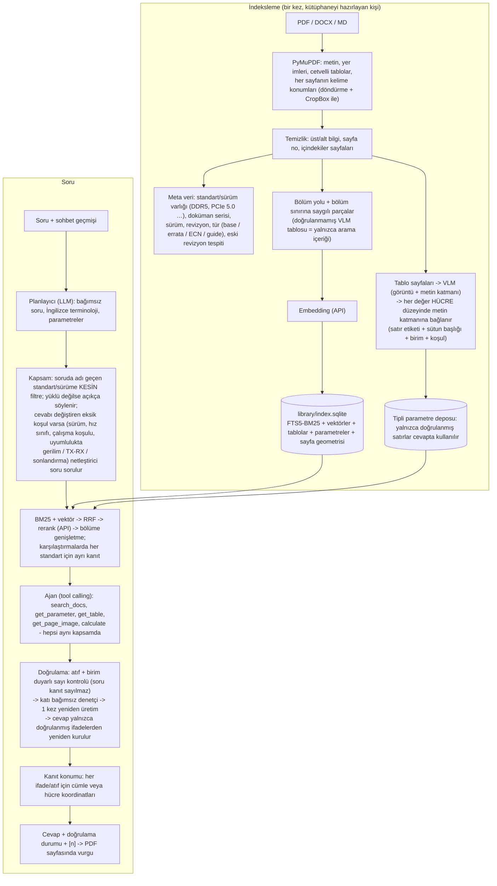

# Sayısal Tasarım Uzmanı — Arayüz ve Tasarım Standartları için Doğrulamalı Asistan

Kullanıcının arayüz/standart sorularını (ARINC, JEDEC DDR, PCIe, Ethernet, DisplayPort, USB, RS-422, I²C,
genel tasarım standartları …) **yalnızca yüklü dokümanlardan** cevaplayan, her ifadeyi **[n] atfıyla kaynağına**
bağlayan, ifadeleri kullanıcıya göstermeden önce **kaynaklara karşı denetleyen** ve atfa tıklanınca dayanılan
cümleyi / tablo hücresini **PDF sayfası üzerinde vurgulayan** bir masaüstü uygulaması.

Öncelik doğruluktur: kanıt yetersizse uygulama "bulunamadı" der; doğrulanamayan bir ifadeyi kesin bilgi olarak
göstermez. Bu, hatasızlık garantisi değildir — denetimler yanlışların bir kısmını yakalar, bir kısmı kaçabilir
(bkz. "Bilinen sınırlar"). Doğruluk ancak kendi dokümanlarınızla, uzman onaylı bir soru setiyle ölçülebilir (§5).

* Windows için tek `SayisalTasarimUzmani.exe` (tarayıcı açılmaz; yerel pencere — Microsoft Edge WebView2).
* Tüm modeller kurum içindeki **vLLM / SGLang** sunucularından (OpenAI uyumlu API) kullanılır:
  sohbet modeli, görsel model, embedding ve reranker ayrı ayrı ayarlanır. Yerelde ağır hiçbir şey çalışmaz.
* Arayüz Türkçe / İngilizce (tek tıkla değişir). Cevap, sorunun dilinde verilir; teknik terimler İngilizce kalır.

---

## 1. Mimari



### Hatalara karşı katmanlar

| Hata kaynağı | Önlem |
|---|---|
| Yanlış standart / sürüm (DDR4 değeri DDR5 cevabında) | Dokümanlar standart+sürüm varlığıyla etiketlenir. Soruda adı geçen standart aramayı **kesin** olarak o etiketi taşıyan dokümanlara daraltır; **etiketsiz dokümanlar kesin eşleşme sayılmaz**. İstenen standart/sürüm yüklü değilse kapsam **genişletilmez**: cevap "yüklü dokümanlarda yok" der ve ilgili yüklü dokümanları listeler. Araçlar (arama, parametre, tablo, sayfa görüntüsü) aynı kapsamı ve kullanıcının doküman/koleksiyon seçimini uygular; başka bir sürüme kaçamaz. Karşılaştırmalarda her standardın kanıtı ayrı toplanır. Standart adı verilmemişse ve kanıt kardeş sürümlerden (DDR4/DDR5 …) geliyorsa sistem cevap yerine **hangi sürümü kastettiğinizi sorar**; bir parametrenin doğrulanmış tablo satırları hız sınıfına / yoğunluğa / sıcaklığa göre farklı değer veriyorsa ve soru bunu söylemiyorsa o koşulu sorar (bkz. "Netleştirici sorular"). |
| Revizyon / belge türü karışması | Kimlik alanları ayrıdır: standart, doküman serisi (JESD79-5, "PCI Express Base", "PCI Express CEM"), sürüm, revizyon, tür. Yalnızca **aynı serinin aynı sürümünün** eski revizyonu yenisiyle geçersiz olur; Base ile CEM veya bir tasarım kılavuzu birbirinin revizyonu sayılmaz. Guide/appnote "bilgilendirici, spesifikasyonu geçersiz kılmaz" diye işaretlenir. Errata/ECN yalnızca ilgili serinin ilgili sürümüne bağlanır ve mümkünse maddeye (§4.2.6.3) bağlanır. Eski bir revizyonu soruda açıkça adlandırırsanız (ör. "JESD79-4B") o revizyon kullanılır. Kaynaklar farklı değer veriyorsa model çelişkiyi iki atıfla belirtmek zorundadır. |
| Tablo hücresinin yanlış okunması (min/max yer değişimi, yanlış birim, yanlış satır) | VLM yalnızca yapı önerir. Her değer, PDF metin katmanında **parametre satırı ile sütun başlığının (ve çok seviyeli başlıkta grup başlığının) kesiştiği tek hücrede** bulunmalı; birim satırda/başlıkta yazmalı; koşullar (8 Gb, DDR4-3200 …) sayfada ve gerekiyorsa aynı satırda olmalı. Sayfada başka yerde geçen aynı sayı kabul edilmez; iki eşit aday varsa belirsizdir. Doğrulanamayan satır **cevapta kullanılmaz** (araçla da geri alınamaz). `max(10 ns, 4 tCK)` gibi ifadeler tek sayıya indirgenmez; bilinmeyen birimler ve "1,200" gibi belirsiz sayı biçimleri SI değerine çevrilmez. |
| VLM birleştirmesinde veri kaybı | Birleştirme **tablo bazındadır**: yalnızca doğrulanmış ve içerik + konum + başlıkla güvenilir eşleşen PDF tablosu değiştirilir. Doğrulanmayan VLM tablosu hiçbir şeyin yerine geçmez; orijinal PDF metni kanıt olarak kalır, VLM sürümü yalnızca aramada kullanılır. Arama böyle bir tabloyu bulursa model sayfanın PDF metnini alır, eşleşmeyen VLM tablosu da yanına **atıf yapılamaz bir okuma yardımı** olarak eklenir (hangi değerin hangi satır/sütuna ait olduğunu görmek için). Doğrulama, denetçi ve kanıt konumu yalnızca PDF metnine bakar; yalnızca okuma yardımında geçen bir değer "doğrulanamadı" sayılır. Gösterilen rerank puanı da modele verilen metnin puanıdır. |
| Dizgi ayrıntıları (alt simge, iki satıra taşan ad, dipnot işareti) | Standartlarda "t" + alt simge "RFC" metin katmanında iki kelime çıkar; bitişik kelimeler tek etiket olarak da aranır. Hücresinde iki-üç satıra taşan parametre adı satır satır, her parça bir öncekinin hemen altında ve aynı hücrede aranır (ikinci satır hangi satır olduğunu belirler: 8Gb / 16Gb). Değerden sonra yükseltilmiş dipnot işareti ("295" + üst simge "1") metin katmanında "2951" diye birleşir; yazı boyutu ve taban çizgisinden ayırt edilir, ayrı tutulur ve hiçbir zaman değer sayılmaz ("2951" artık basılı değer kabul edilmez). Metinde ve tablolarda "295⁽1⁾" (295, dipnot 1) ve "10^-12" (on üzeri −12) olarak görünür. Kelime içindeki üst simge (I²C), sıra eki (1st), TM ve birim üssü (mm²) değişmez. Değer yine satır etiketi ile sütun başlığının kesişiminde olmalıdır. |
| Model "biliyorum" diye uyduruyor | Cevap sözleşmesi: giriş cümlesi dahil her teknik ifade [n] atıflı; mühendislik yorumu dayandığı kaynakları ve varsayımlarını gösterir. Atıfsız teknik ifade (başlıktan önce veya sonra, sayılı veya sayısız) denetimden kaçamaz. |
| Sorudaki değerin "standart değeri" gibi sunulması | Kullanıcının verdiği değerler ayrı bir **kullanıcı girdisi** kaynağıdır; belgeye dayanan ifadeler yalnızca atıf yapılan belge metniyle doğrulanır. Kullanıcı değeri hesapta kullanılabilir ama standart değeri gibi sunulamaz. |
| Hesap hatası / kaynaksız girdi | Hesaplar `calculate` aracıyla yapılır; ifadedeki her sayı bir kaynağa veya kullanıcı girdisine **izlenir**. Kaynaksız girdi içeren hesap, aritmetiği doğru olsa da doğrulanmış ifadeyi desteklemez. |
| Yine de hatalı ifade | **Deterministik kontrol** (atıf var mı, sayı+birim atıf yapılan kaynakta mı — 0,35 µs = 350 ns) → **bağımsız denetçi** (taze bağlam: yalnızca iddia + atıf yapılan kaynak). Denetçinin yalnızca o iddia kimliği için açık ve geçerli bir "supported" kararı onay sayılır; zaman aşımı, API hatası, bozuk/eksik/tekrarlı karar, token sınırında kesilmiş yanıt **onay değildir**. Denetçi istekleri modelin bağlam uzunluğuna (ayar veya sunucunun bildirdiği `max_model_len`, hangisi küçükse) yanıt payıyla birlikte sığacak şekilde gruplanır; başarısız bir istek ifade ifade, bağlam aşımı veya kesik yanıtta daha kısa alıntılarla yeniden denenir. Teknik bir denetçi hatası "doğrulanamadı" olarak, denetçinin "desteklenmiyor" kararından ayrı gösterilir. Desteklenmeyen ifadeler bir kez yeniden ürettirilir; cevap yalnızca **doğrulanmış ifadelerden** yeniden kurulur. |
| Yanlış atıf (değer doğru, köşeli parantezdeki kaynak yanlış) | Bir ifadenin **tek** sorunu değerlerinin atıf yaptığı kaynakta olmaması ise ve cevapla birlikte verilen başka bir doğrulanmış kaynak bu değerlerin **hepsini** yazıyorsa, o kaynağın atfı mevcut atfın yanına eklenir (önce aynı belgeden kaynak). İfade baştan yeniden kontrol edilir ve **denetçinin onayı yine gerekir**; metnin geri kalanı değişmez. Düzeltme ifade ayrıntılarında "atıf düzeltildi" olarak gösterilir. Başka bir sorun varsa (atıfsız ifade, var olmayan kaynak, kaynakta hiç olmayan değer) düzeltme yapılmaz. |
| Soru tasarım dilinde, standart gereksinimi kendi terimleriyle yazıyor ("length matching gerekir mi?" ↔ intra/inter-pair skew sınırı) | Bunu bir eşleme tablosu değil LLM kurar, iki noktada: (1) planlayıcı, sorulan kavramı standartta hangi gereksinimin (sınır, zamanlama, elektriksel parametre, zorunlu prosedür) belirlediğini düşünüp onlar için de standardın terimleriyle arama sorgusu ve "standart bunu nasıl yazardı" diye değersiz (sayılar X) bir cümle üretir; bu cümle yalnızca anlamsal aramada kullanılır, kanıt olmaz ve gösterilmez. Ek model çağrısı yoktur. (2) Cevap modeli "bulunamadı" derse bir kez, ilgili gereksinimi araçlarla standardın terimleriyle araması istenir (araç çağırma açıksa; yalnızca bu cevaplarda bir model turu daha). Cevap kuralı: gereksinim atıfla verilir, tasarım sonucu "Mühendislik yorumu" bölümünde açıklanır; kaynakta olmayan bir değere dayanan sayısal dönüşüm (ör. ps → mm için kartın mm başına gecikmesi) sayı olarak verilmez — kullanıcı o değeri soruda verirse hesap onun varsayımı olarak yapılır. Doğrulama aynı. |
| Kanıt başka tabloda / bölümde ("bkz. Tablo 4-12") | Bulunan bir pasaj "Table 4-12", "Section 3.2", "clause 5.4.1", "§ 4.5" diye başka bir tabloya/bölüme başvuruyorsa, o tablo (başlık satırından bulunur; düz metindeki bir anma değil) veya bölüm **aynı belgeden** ayrı bir kaynak olarak eklenir — en fazla 3 başvuru, her biri ~1200 token; kaynak listesinde "↪ başvurulan Tablo 4-12" diye işaretlenir. Kapsam dışına çıkılmaz (başvuru belgesinin kendisindedir). |

### Doğrulama durumları

Her ifade için: **destekleniyor** · **desteklenmiyor** · **doğrulanamadı** (kontrol tamamlanamadı, ör. denetçi
hata verdi) · **uygulanmadı** (doğrulama veya denetçi Ayarlar'da kapalı). Cevap düzeyinde: tümü doğrulandı /
bazıları çıkarıldı / bulunamadı / doğrulama tamamlanamadı / uygulanmadı / **netleştirme gerekiyor** (cevap,
belirtilmemiş bir koşula bağlı; "kaynakta bulunamadı" sonucundan ayrıdır). "Denetçi çağrıldı" ile
"denetçi başarıyla tamamlandı" ayrı alanlardır; arayüz yalnızca kontrol denendi diye "doğrulandı" demez.
Akış sırasında yazılan taslak yalnızca ilerleme olarak (katlanmış, "doğrulanmamış" etiketiyle) gösterilir.

### Yerel hesaplama bütçesi

| Yerelde (exe) | Sunucuda (vLLM) |
|---|---|
| PDF ayrıştırma (PyMuPDF), kelime konumlarının çıkarılması (~2 ms/sayfa, indekslemede bir kez), sayfa render (yalnızca VLM sayfaları ve görüntülenen sayfalar), SQLite FTS5, numpy ile vektör arama, birim/sayı doğrulama, hücre eşleştirme ve kanıt konumu (cevap başına onlarca ms) | Sohbet + görsel model, embedding, reranker |

Exe ~65 MB (tek dosya); GPU, torch veya model dosyası gerektirmez. Sayfa geometrisi indekste sayfa başına
yaklaşık 4–8 KB yer kaplar (1000 sayfalık bir standart ≈ 5–8 MB). Vurgulama için tıklama başına model çağrısı
yapılmaz; konumlar indekslemede bir kez çıkarılır.

**Soru başına LLM çağrısı (doğruluk öncelikli mod):** planlayıcı 1 + cevap 1 (+ araç turları, en fazla 4) +
denetçi: bağlama sığan bir veya birkaç istek (paralel; başarısız istekteki ifadeler tek tek, bağlam aşımı veya
kesik yanıtta bir kez daha kısa alıntılarla) + gerekirse yeniden üretim 1 + yeniden denetim. Model ilk turda
"bulunamadı" derse bir tur daha (ilgili gereksinimi arama hatırlatması; araç turu sınırı içinde). Embedding 1, rerank 1 istek (karşılaştırma sorularında standart başına 1). Standart yüklü
değilse veya netleştirici soru soruluyorsa cevap modeli hiç çağrılmaz.

---

## 2. Kurulum

### 2.1 Exe'yi almak

GitHub Actions her push'ta Windows derlemesi yapar (**Actions → Build Windows exe → Artifacts → SayisalTasarimUzmani-windows**):

* `SayisalTasarimUzmani-portable.exe` — tek dosya, kopyala-çalıştır.
* `SayisalTasarimUzmani-win64.zip` — klasör sürümü (daha hızlı açılır; `SayisalTasarimUzmani.exe` içinde).

`v*` etiketi atılırsa (ör. `git tag v1.0.0 && git push --tags`) dosyalar GitHub Release'e de eklenir.
Derleme, dondurulmuş exe üzerinde `SayisalTasarimUzmani.exe selftest` çalıştırarak PDF ayrıştırma, indeksleme, arama,
gömülü arayüz ve pywebview'in pakete girdiğini doğrular. Exe'yi kapalı ağa normal dosya olarak taşıyın.

**Gereksinim:** Microsoft Edge **WebView2 Runtime** (Windows 11'de hazır; Windows 10'da yoksa Microsoft'un
"Evergreen Standalone Installer" çevrimdışı kurulumunu bir kez çalıştırın).

### 2.2 Model sunucuları (vLLM)

`deploy/vllm-serve-example.sh` dört uç nokta için örnek komutları içerir. Önemli bayraklar:

* Sohbet modeli: `--enable-auto-tool-choice --tool-call-parser hermes` (araçlar için) ve
  `--reasoning-parser qwen3` (düşünme metni cevaba karışmasın). Görsel giriş için `--limit-mm-per-prompt`.
  Modelinizin kartında önerilen parser adlarını kullanın.
* Embedding: `--runner pooling` (eski sürümlerde `--task embed`), ör. Qwen3-Embedding-0.6B.
* Reranker: Qwen3-Reranker için `--hf_overrides` (dosyada); bge-reranker-v2-m3 ek ayar istemez.

Sunucu araç çağrısını desteklemiyorsa uygulama bunu fark eder ve araçsız (ön-getirilmiş kaynaklarla) devam eder.

### 2.3 İlk açılış: Ayarlar

**Ayarlar** penceresinde her servis için **API adresi** (`http://sunucu:8000/v1`), **API anahtarı** ve
**Model** girilir. Model listesi sunucunun `/v1/models` ucundan **otomatik çekilir** ve açılır listede gösterilir;
**Test et** düğmesi bağlantıyı ve modeli dener (embedding boyutu, rerank skoru, LLM cevabı).

* Görsel model: "Sohbet modeliyle aynı" (çok kipli Qwen: şekil sayfaları cevap modeline görüntü olarak gider)
  veya ayrı bir VLM (sohbet modeli yalnızca metin alıyorsa sayfa görüntüleri VLM tarafından metne dökülür).
* Düşünme modu: `auto` (karşılaştırma / çok parçalı sorularda açık), `on`, `off`; kontrol yöntemi
  `chat_template` (Qwen `enable_thinking`) veya `reasoning_effort`.
* Doğrulanamayan iddialar: **Kaldır** (varsayılan) veya **İşaretle**.
* **Gelişmiş:** model bağlam uzunluğu (token; sunucunun bildirdiği değer yanında gösterilir, küçük olan
  kullanılır), denetçinin bir istekte göreceği en fazla ifade, yanlış atıf düzeltmesi (açık/kapalı), "bulunamadı"
  demeden önce ilgili gereksinimi bir kez daha aratma (açık/kapalı), izlenecek
  tablo/bölüm başvurusu sayısı (0 = kapalı), VLM tablo sayfası eşiği ve belge başına VLM sayfa sınırı. Değerler
  aralık denetiminden geçer. VLM eşiği veya sayfa sınırı değişirse belgeler bir sonraki taramada yeniden işlenir
  (daha önce okunan sayfalar önbellekten gelir).

Ayarlar `%APPDATA%\SayisalTasarimUzmani\settings.json` dosyasına yazılır; API anahtarları **Windows DPAPI** ile kullanıcı
hesabına bağlı şifrelenir.

**Eski adla (TechRAG) kurulmuş bir bilgisayarda** `%APPDATA%\TechRAG` (ayarlar, API anahtarları, günlük, pencere
durumu) ve `%USERPROFILE%\TechRAG\library` (varsayılan kütüphane) klasörleri varsa olduğu gibi kullanılmaya devam
eder; hiçbir şey taşınmaz veya silinmez. Yeni kurulumlar `SayisalTasarimUzmani` adlı klasörleri kullanır. Python
paketi (`techrag`), komut satırı adı ve `TECHRAG_*` ortam değişkenleri uyumluluk için teknik ad olarak kaldı.

---

## 3. Kütüphane

### 3.1 Belge klasörü ekle (önerilen)

Belgeleriniz zaten klasörlerde duruyorsa ana klasörü bir kez seçin:

```
Teknik_Belgeler\                    <- seçilen ana klasör
├── PCIe\        Base_Specification.pdf, CEM.pdf          -> bucket "PCIe"
├── Ethernet\    Standard.pdf, Design_Guide.pdf           -> bucket "Ethernet"
├── DDR\
│   ├── DDR4\    Specification.pdf                        -> bucket "DDR" (alt yol "DDR4")
│   └── DDR5\    Specification.pdf                        -> bucket "DDR" (alt yol "DDR5")
└── Genel_Not.pdf                                          -> "Genel (ana klasör)"
```

1. Sol panelde **Belge klasörü ekle** → Windows klasör seçme penceresinde ana klasörü seçin.
2. Önizleme penceresi bulunan **bucket'ları ve belge sayılarını**, atlanacak desteklenmeyen dosyaları, boş
   klasörleri, izlenmeyen bağlantıları ve okunamayan öğeleri gösterir (bu aşamada hiçbir şey indekslenmez).
3. **İndeksle** → tüm koleksiyon arka planda işlenir; panelde ilerleme (bucket, dosya, tamamlanan/toplam,
   hatalar) görünür, pencere donmaz. Bir dosyanın işlenememesi diğerlerini durdurmaz; hatalı dosyalar listelenir.

Kurallar:
* Ana klasörün **doğrudan altındaki klasörler** bucket'tır; daha derindeki klasörler aynı bucket'ta kalır ve
  göreli alt yol ayrıca saklanır. Bucket adı klasör adının kendisidir (Türkçe karakterler ve boşluklar korunur;
  içeride ayrı bir ASCII kimlik kullanılır). Dosya adından veya model tahmininden üretilmez.
* Klasör adı yalnızca **koleksiyon bilgisidir**; belgenin standart/revizyon kimliği belgenin kendisinden
  (başlık, ön sayfalar, meta veri) çıkarılır. `DDR/DDR5/Specification.pdf` klasöründe olduğu için DDR5 sayılmaz.
* Farklı klasörlerdeki aynı adlı dosyalar ayrı belgelerdir; birbirinin üzerine yazılmaz.
* Sembolik bağlantılar ve junction'lar izlenmez; seçilen klasörün dışına çıkılmaz, döngüye girilmez.
* Belgeler **bulundukları yerden okunur**: kaynak klasöre hiçbir şey yazılmaz, dosyalar taşınmaz veya yeniden
  adlandırılmaz, yazma izni gerekmez. İndeks ve önbellek kütüphane klasöründe tutulur.

### 3.2 Yeniden tara

Sol paneldeki **⟳ (Yeniden tara)** önce neyin değiştiğini gösterir, onaydan sonra uygular:

| Durum | Ne yapılır | API maliyeti |
|---|---|---|
| Yeni / içeriği değişmiş | Tam işlenir | VLM + embedding (+ meta veri LLM) |
| Ayrıştırma/tablo çıkarımı ayarları değişmiş | Yeniden işlenir | Embedding; VLM sonuçları model/ayar değişmediyse önbellekten |
| Değişmemiş (boyut+tarih aynı, ya da tarih değişse de SHA-256 aynı) | Atlanır | Yok |
| Taşınmış / başka klasöre kopyalanmış aynı içerik | İndeks satırları yeniden kullanılır | Yok |
| Kaynağı silinmiş | İndekste kalır ama **cevaplarda kullanılmaz**, kullanıcıya listelenir; "İndeksten kaldır" ile silinir | Yok |
| Klasör erişilemiyor (ör. ağ paylaşımı kopuk) / alt klasör okunamıyor | **Hiçbir belge silinmiş sayılmaz**, olduğu gibi bırakılır | Yok |

Embedding modeli değiştiyse tam yeniden indeksleme gerekir (uygulama bunu söyler). Model sunucusu hız sınırına
takılırsa (HTTP 429/503) `Retry-After` beklemesine uyulur; servis başına en fazla 3 deneme, en fazla 60 sn
bekleme (`max_retries`, `max_retry_wait`). Eşzamanlılık sınırlıdır (`embedding.concurrency`,
`vision.concurrency`, varsayılan 4).

### 3.3 İndeksleme kalite raporu

Sol paneldeki **📋** düğmesi (veya indeksleme bittiğinde iş kutusundaki "Kalite raporu") raporu açar. Rapor
indekste kalıcıdır (yeniden açılışta kaybolmaz) ve **indekslemenin ne yaptığını** anlatır; cevap doğruluğu ölçüsü
değildir.

* **Son çalıştırma özeti:** işlenen (yeni/güncellenen), değişmediği için atlanan, yeniden kullanılan (taşınmış/kopya),
  kısmen işlenen, başarısız, erişilemeyen ve kaynağı olmayan belge sayıları; VLM için incelenen sayfa (kaçı
  önbellekten), tablo bulunan sayfa, **incelenip tablo bulunmayan** sayfa, **VLM'in başarısız olduğu** sayfa,
  tablo işareti bulunmayan veya eşiğin altında kalan (incelenmeyen) ve sayfa sınırı yüzünden incelenmeyen
  sayfalar (bkz. "VLM'e hangi sayfalar gider"); çıkarılan,
  PDF metniyle hücre hücre eşleşen ve eşleşmeyen tablolar; doğrulanan/doğrulanamayan parametre satırları (oran
  her zaman paydasıyla: "4/4 doğrulandı (%100) — payda: VLM'in çıkardığı satırlar"); embedding ve indeks yazma
  hataları. VLM kapalıysa bu açıkça yazılır ("tablolar yalnızca PDF metninden okundu").
* **Belge ayrıntıları:** belge adı, bucket, son işlem zamanı, yeniden işleme gerekip gerekmediği; her sorun için
  aşama (okuma / ayrıştırma / belge bilgisi / VLM / embedding / indeks yazımı), PDF sayfası, varsa tablo adı,
  anlaşılır neden ve önerilen işlem. Kaynak PDF mevcutsa **"Sayfaya git"** o sayfayı sağ panelde açar.
  Başarısız bir belgenin önceki indeksi varsa "önceki indeks korunuyor ve cevaplarda kullanılıyor" yazar.
* Doğrulanmamış tablo satırları raporda görünse de **cevaplarda kullanılmaz** (kurallar değişmedi).
* Bu sürümden önce indekslenmiş belgeler için "kalite bilgisi mevcut değil" yazar; tahmin yapılmaz. Bilgi, belge
  bir sonraki işlenişinde oluşur.
* Rapora API anahtarı, sunucu adresi, IP veya erişim anahtarı yazılmaz: hata ayrıntılarından bunlar silinir.

**Başarısız işlemleri yeniden dene:** önce kapsamı gösterir, sonra uygular.

| Ne başarısız oldu | Yeniden denemede ne yapılır |
|---|---|
| Bazı sayfalarda VLM (belge kısmen işlendi) | Yalnızca başarısız sayfalar VLM'e gider; başarılı sayfalar önbellekten gelir, değişmeyen parçalar mevcut embedding'ini korur |
| Belge bilgisi (LLM) | Belge yeniden işlenir; VLM sayfaları önbellekten |
| Okuma / ayrıştırma / embedding / indeks yazımı | Belge düzeyinde yeniden işlenir (kapsam raporda "belge düzeyinde" olarak gösterilir) |
| Erişilemeyen belge klasörü | Klasör yeniden taranır |

Her belge tek bir SQLite işleminde (kalite kaydıyla birlikte) yazılır. **Başarısız bir deneme mevcut indeksi
silmez**; daha fazla başarısız sayfayla biten bir deneme de yazılmaz ("sonuç daha iyi değil, mevcut indeks
korundu"). Komut satırı: `quality` ve `retry`.

**VLM'e hangi sayfalar gider:** yalnızca gerçek bir tablo işareti olan sayfalar — satır başında bir tablo
başlığı ("Table 4-12 DC characteristics"; düz metinde geçen "Table 4-2 shows …" sayılmaz), PDF tablo
algılayıcısının bulduğu çizgili tablo veya kelime konumlarından bulunan, en az üç ortak sütunda hizalı satırlar
(çizgisiz tablo; döndürülmüş sayfalar dahil). Değerler ve "min/max/typical" kelimeleriyle dolu düz metin tek
başına yeterli değildir. Bu sayfalar arasında puan (başlık, tablo sözcükleri, değer sayısı) sıralama ve eşik
(`vision.min_page_score`) için kullanılır. Bu kural 0.7.0'da geldi; daha önce indekslenmiş belgeler yeniden
işlenmez (mevcut tablolar korunur), yeni/değişen belgelere ve yeniden indekslemeye uygulanır.

### 3.4 Kütüphane klasörü ve tek dosya ekleme

```
<kütüphane>\
├── sources\          tek tek eklenen dosyaların kopyaları (<koleksiyon>\dosya.pdf)
├── index.sqlite      (FTS5 + vektörler + tablolar + parametreler + sayfa geometrisi + belge klasörleri)
└── cache\vlm\        (VLM ve meta veri sonuçları; aynı sayfa ikinci kez ücretlendirilmez)
```

* Varsayılan konum `%USERPROFILE%\SayisalTasarimUzmani\library`; **Kütüphane** penceresinden değiştirilir.
* **Doküman ekle** (sol panelin altında): koleksiyon adı + dosyalar → `sources\<koleksiyon>` içine kopyalanır ve
  indekslenir. Aynı adlı farklı bir dosya varsa `Ad (2).pdf` olarak kaydedilir.
* Dosya adına standart ve sürümü yazmak etiketlemeyi kesinleştirir (`JESD79-5B_DDR5.pdf`, `PCIe_Base_5.0.pdf`).
  Errata/ECN dosyalarının adında "Errata"/"ECN" geçsin.
* Standart/sürüm kalıpları `techrag/resources/domains.yaml` içindedir (koleksiyon klasörleri, desenler,
  kısaltma sözlüğü, Türkçe→İngilizce terimler). Yeni bir standart ailesi bir YAML bloğu ile eklenir.
* Taranmış PDF'ler önce OCR'dan geçirilmeli (`ocrmypdf`); metin katmanı olmayan sayfalarda ne tablo
  değerleri doğrulanabilir ne de kanıt konumu gösterilebilir (uygulama sahte konum üretmez).
* Orijinal PDF'ler değiştirilmez: vurgular yalnızca arayüz katmanında çizilir, PDF'e annotation yazılmaz.

**0.5 ve öncesiyle oluşturulmuş kütüphane:** açılışta indeks şeması 5'e yükseltilir — yalnızca iki yeni tablo
(kalite raporu) eklenir; belgeler, parçalar, embedding'ler, tablolar ve ayarlar değişmez. Salt-okunur açılan eski
kütüphanede rapor "mevcut değil" der.

**Eski sürümle indekslenmiş kütüphane (0.1.x):** açılışta şema yerinde güncellenir; eski sürümün sayfa
düzeyi kontrolle "doğrulanmış" saydığı parametre satırları ve VLM tabloları güvenilmez kabul edilir (cevapta
kullanılmaz). Arayüzde uyarı çıkar. **Kütüphane → "Konum verisini oluştur (hızlı geçiş)"** (veya
`SayisalTasarimUzmani.exe migrate`) kaynak PDF'lerden sayfa geometrisini çıkarır ve önbellekteki VLM tablolarını hücre
düzeyinde yeniden doğrular — **yeniden embedding ve VLM çağrısı yapmaz**. Eski sürüm, doğrulanan VLM tablosunun
orijinal PDF metnini indekse koymuyordu; hücre düzeyinde doğrulanamayan bu tür tablolar için geçiş raporu tam
yeniden indeksleme önerir (`ingest --rebuild`: VLM sonuçları önbellekten gelir, yalnızca embedding yeniden
hesaplanır). Salt-okunur paylaşılan kütüphaneler yerinde güncellenemez: hazırlayan kişi geçişi yapıp yeniden
yayımlamalıdır.

**Paylaşım:** kütüphaneyi hazırlayan kişi **Kütüphane → Yayımla** ile temiz bir kopya üretir (tek dosya
indeks + kaynaklar + VLM önbelleği). Belge klasörlerinden okunan dosyalar pakete **açıkça kopyalanır**
(`sources\<bucket>\<alt yol>\...`) ve kopyadaki indeks bunları gösterir; böylece paket başka bilgisayarda da
çalışır. Kaynak dosyalar yalnızca okunur. Diğer kullanıcılar bu klasörü (ağ paylaşımı dahil, `\\sunucu\paylaşım\...`)
**salt-okunur** açar: kilit kullanmaz, ağ paylaşımında güvenlidir. Güncellemeyi yeni bir klasöre yayımlayıp
kullanıcıların onu açması önerilir (açıkken üzerine yazmayın).

---

## 4. Kullanım

### Açılış: sohbet simgesi

* `SayisalTasarimUzmani.exe` açılınca önce ekranın sağ alt köşesinde (görev çubuğunun üstünde) küçük bir
  **mikroçip simgesi** belirir (uygulamanın içinde çizilir; internetten bir şey indirilmez, her monitörün
  ölçeğinde keskin görünür, köşeleri saydamdır). Simge normal pencerelerin üzerinde kalır ama klavye odağını
  almaz; yazdığınız uygulama odakta kalır. Ayrı bir tarayıcı açılmaz.
* **Sol tık sohbet penceresini açar/gizler:** pencere gizliyse gösterilip öne alınır; görünür ve öndeyse
  gizlenir; simge durumuna küçültülmüş veya başka pencerelerin arkasındaysa gizlenmez, geri yüklenip öne
  getirilir. Çift tık pencereyi açık bırakır (ikinci tık kapatmaz); hızlı ardışık tıklamalar sırayla işlenir,
  ikinci bir pencere açılmaz. Gizlemek uygulamadan çıkmak değildir. Pencere normal bir penceredir:
  boyutlandırılabilir, ekranı kaplayabilir, üstte sabit kalmaz. Simge sohbet penceresinin de üzerinde kalır,
  pencere etkinken ve simgenin köşesini kapladığında (ör. ekranı kapladığında) bile kaybolmaz; simge gönder
  düğmesinin üstüne gelirse soru kutusu ve gönder düğmesi simgenin soluna kayar.
* **Sürükleyerek** simge taşınır (sürükleme sohbeti açmaz); yeri, bulunduğu monitör ve en yakın köşeye uzaklığıyla
  hatırlanır. Çözünürlük, ölçek (DPI) veya görev çubuğu değişince, monitör çıkarılınca simge görünür alana geri
  alınır; her monitörde o monitörün ölçeğinde çizilir.
* **Sağ tık menüsü:** "Sohbeti aç", "Ayarlar", "Uygulamadan çık" (arayüz dili TR/EN).
* Sohbet penceresinin **kapat (✕)** düğmesi de uygulamadan çıkmaz, pencereyi gizler (ilk seferde kısa bir bilgi
  gösterilir). Simgeyle veya ✕ ile gizlerken sohbet geçmişi, seçili bucket, açık PDF sayfası ve panel
  genişlikleri korunur; süren indeksleme arka planda devam eder. Gizliyken arayüz ilerleme sorgulamaz.
* **Tamamen çıkmak** için simgeye sağ tıklayıp "Uygulamadan çık". İndeksleme sürüyorsa onay istenir; o an
  yazılan belge kaydı tamamlanır, sonraki belgeler bir sonraki "Yeniden tara"da işlenir (indeks yarım kalmaz).
* `SayisalTasarimUzmani.exe` ikinci kez çalıştırılırsa yeni bir arka uç başlatılmaz; çalışan uygulamanın sohbet penceresi öne
  gelir. Uygulama Windows başlangıcına eklenmez.
* Simgenin yeri ve tek seferlik bilgiler `%APPDATA%\SayisalTasarimUzmani\desktop.json` dosyasındadır (silinirse simge
  varsayılan köşeye döner).

### Sohbet penceresi

* **Sol panel (Kaynaklar):** belgeler bucket başlıkları altında gruplanır; bucket'lar başlangıçta kapalıdır,
  başlığa tıklayınca açılır, yanında belge sayısı görünür. Üstteki arama kutusu belge ve bucket adına göre
  süzer. Uzun adlar üç noktayla kısalır; üzerine gelince tam ad ve göreli konum görünür. Liste kendi içinde
  kayar. Panel **«** ile tamamen daraltılır, üst çubuktaki **☰** ile yeniden açılır; açık/kapalı durumu ve
  açık bucket'lar bir sonraki açılışta korunur.
* **Kapsam:** bir bucket'ın kutusunu işaretlemek aramayı o bucket'ın belgeleriyle sınırlar; tek tek belge de
  seçilebilir. Seçim panelin üstünde "Kapsam: DDR, 2 belge" gibi gösterilir ("Temizle" ile kaldırılır); panel
  daraltılsa da seçim değişmez (☰ düğmesi kapsam varken renklenir). Bucket içinde de soruda geçen
  standart/sürüm filtresi ve revizyon kuralları uygulanır: DDR5 sorulup seçili bucket'ta DDR5 yoksa cevap
  "seçili kapsamda yok" der ve seçim dışındaki ilgili belgeleri listeler.
* **Sağ panel (Kaynak/PDF):** sohbetle arasındaki dikey ayırıcıyı fareyle sürükleyerek genişletip daraltın
  (klavye: ayırıcıya Tab ile gelip ← / → ile 20 px, Shift ile 80 px, Home/End en geniş/en dar, Enter gizle;
  çift tık varsayılan genişlik). Sohbet en az 380 px, kaynak paneli en az 300 px kalır. **Kaynak paneli**
  düğmesi paneli gizler/gösterir; bir atfa tıklamak paneli otomatik açar. Genişlik ve gizli/açık durumu
  korunur; daha küçük bir ekranda açılırsa pencereye göre sınırlanır. Pencere 980 px'ten darsa paneller
  taşmak yerine kayan çekmeceye dönüşür. PDF sayfası panel genişliğine uyar; vurgu koordinatları sayfaya oranla
  tutulduğu için genişlik ve yakınlaştırma değişse de hizalı kalır.
* **Soru:** Sorunuzu yazın. Soruda geçen standart/sürüm kapsamı belirler ("kapsam: DDR5"). Standart yüklü
  değilse "yüklü değil: DDR5" görünür ve cevap uydurulmaz. Sohbette daha önce adı geçen standart, standart
  belirtmeyen değer sorularında ("Peki tREFI?") korunur ("sohbetten: DDR4").
* **Netleştirici sorular:** cevap, soruda belirtilmeyen bir koşula göre gerçekten değişiyorsa sistem cevap yerine
  en fazla üç kısa soru sorar: kanıt birden çok standart/sürümden geliyorsa sürüm; bir parametrenin doğrulanmış
  tablo satırları hız sınıfına, yoğunluğa veya sıcaklığa göre farklıysa o koşul; elektriksel uyumluluk
  sorularında gerilim seviyeleri, TX/RX rolleri ve sonlandırma. Genel sorular ("DDR arayüzü nedir?") doğrudan
  cevaplanır; soruda, sohbette veya açıkça seçilen belgelerde zaten olan bilgi yeniden sorulmaz (seçili bir
  **bucket** sürüm seçimi sayılmaz). Seçenekler yalnızca kütüphanede bulunanlardan (yüklü standartlar, doğrulanmış
  tablo satırlarındaki koşullar) düğme olarak sunulur; serbest metin de yazılabilir. Kısa cevabınız ("DDR4, 2400
  MT/s") bekleyen soruyla birleştirilir (giriş kutusunun üstünde gösterilir, "Vazgeç" ile iptal edilir); yeni bir
  soru sormak veya "Yeni sohbet" bekleyen soruyu bırakır. "Bilmiyorum" derseniz kesin değer veya uyumluluk kararı
  verilmez; cevap, kaynaklarda yazdığı kadarıyla koşullara bağlı olarak açıklanır ve bu bir notla belirtilir.
  Netleştirme sorusu sabit bir şablondur, teknik iddia içermez; doğrulamayı atlatan bir yol değildir. Seçimle
  çelişen bir cevap (yalnız DDR4 seçiliyken "DDR5") sessizce kullanılmaz: "seçili kapsamda yok" denir.
* **Cevap biçimi:** önce doğrudan cevap, sonra kısa paragraflar. Liste yalnızca adımlar, birbirinden bağımsız
  koşullar, seçenekler veya kontrol listesi için; tablo karşılaştırma veya çok sayıda sayısal değer için
  kullanılır; "tablo halinde", "madde madde" gibi bir biçim isterseniz ona uyulur. Atıflar desteklediği ifadenin
  hemen yanındadır; paragraftaki her ifade ayrı ayrı doğrulanır (paragraf sonundaki tek atıf önceki ifadeleri
  doğrulamaz). Kaynakta yazan bilgi ile mühendislik yorumu ayrı bölümlerde kalır.
* **Cevap akışı:** taslak, "doğrulanmamış" etiketli katlanmış bir alanda ilerleme olarak görünür; araç
  çağrıları ve isteğe bağlı model düşünmesi listelenir. Doğrulama bitince yalnızca doğrulanmış ifadelerden
  kurulan son cevap gösterilir.
* **Doğrulama kutusu:** cevap durumu, denetçinin tamamlanıp tamamlanmadığı, çıkarılan/işaretlenen ifadeler
  (gerekçesi arayüz dilinde: "'1.25 V' değeri atıf yapılan kaynaklarda bulunamadı", "Bağımsız denetleyici:
  kaynaklar bu ifadeyi desteklemiyor", "Denetleyiciye ulaşılamadı … (teknik sorun; ifade yanlış bulunmadı)") ve
  "İfade ayrıntıları" (her ifadenin durumu; kullanıcı girdisi / hesap içerip içermediği; "atıf düzeltildi").
  Dipnot işaretli değerler "295⁽1⁾" (295, dipnot 1), on üzeri gösterimler "10^-12" olarak yazılır.
* **Geri bildirim:** her cevabın altında 👍 (doğru/faydalı, hemen kaydedilir) ve 👎 (yanlış/eksik). 👎 kısa bir
  form açar: doğru değer, birim, parametre, belge, sayfa, not ve "belgeler bu soruyu cevaplamıyor". Kayıtlar
  yalnızca bu bilgisayarda kullanıcı klasöründe (`%APPDATA%\SayisalTasarimUzmani\feedback.json`) tutulur;
  kütüphaneye yazılmaz (salt okunur paylaşılan kütüphanede de çalışır). Kaynak metni, kütüphane yolu, sunucu
  adresi veya anahtar saklanmaz. **Değerlendirme** penceresinden aday değerlendirme maddeleri olarak dışa
  aktarılabilir.

### PDF'de kanıt vurgulama

1. Cevaptaki **[n]** atfına tıklayın: sağdaki kaynak paneli doğru dokümanı ve sayfayı açar.
2. O ifadeyi destekleyen **cümle**, ya da tablo değerlerinde **değer hücresi + parametre adı + sütun başlığı
   (+ birim, grup başlığı, dipnot)** sayfa üzerinde renkli kutularla işaretlenir. Aynı sayı sayfada birkaç yerde
   geçiyorsa yalnızca satır/sütun ilişkisiyle eşleşen hücre işaretlenir; eşleşme belirsizse hiçbiri.
3. **‹ Önceki kanıt / Sonraki kanıt ›** ile bölgeler (başka sayfalardakiler dahil) arasında gezinin;
   **Vurgu** kutusu vurguyu gizler/gösterir; **− / +** yakınlaştırır (vurgu hizası korunur).
4. Panelde iki ayrı durum görünür: **Doğrulama** (ifade kaynakla destekleniyor mu) ve **Konum** (kanıt sayfada
   bulundu mu). Konum bulunması ifadenin doğru olduğu anlamına gelmez.
5. Kesin yer bulunamazsa "Kaynak sayfası bulundu, kesin konum eşleştirilemedi" yazar; metin katmanı yoksa veya
   kütüphane eski sürümle indekslenmişse bu da açıkça söylenir. PDF kaynaklarında panelde yalnızca sayfa
   görüntüsü ve kısa kaynak bilgisi (belge, revizyon, bölüm, sayfa) bulunur; çıkarılan metin sayfanın altında
   ayrıca listelenmez, boşalan yer sayfaya verilir (metin indekste kalır, arama ve doğrulama onu kullanır).
   Sayfa görüntülenemiyorsa (dosya taşınmış/silinmiş) bu yazılır ve alıntılanan metin incelenebilir. PDF olmayan
   kaynaklarda belge bilgisi, "Orijinal dosyayı aç" ve "Kaynak metnini incele" (kanıt işaretli) gösterilir. **Hesap** kaynaklarında sonuç PDF'te aranmaz; girdileri ve her girdinin kaynağı listelenir
   (tıklanınca o girdinin konumu gösterilir). **Kullanıcı girdisi** kaynağı bir doküman değildir.
6. Sayfa göstergesi fiziksel sayfa indeksini ve PDF'in basılı sayfa etiketini ayrı gösterir
   ("Sayfa 23 / 300 (basılı: 21)").

Kaynak kayıtları kalıcı bilgiler taşır: doküman SHA-256'sı, fiziksel sayfa, basılı etiket, eşleşen metin ve
hem ekran (0–1, döndürme/CropBox uygulanmış) hem PDF kullanıcı uzayı koordinatları.

### Komut satırı (aynı exe)

```bat
SayisalTasarimUzmani.exe doctor                    :: uç noktalar, modeller, indeks kontrolü
SayisalTasarimUzmani.exe models                    :: her uç noktanın sunduğu modeller
SayisalTasarimUzmani.exe ingest                    :: artımlı indeksleme (VLM tablo çıkarımı dahil)
SayisalTasarimUzmani.exe ingest --rebuild          :: embedding modeli değişince / eski indeksin tam yenilenmesi
SayisalTasarimUzmani.exe migrate                   :: eski (0.1.x) indeksi yerinde güncelle (embedding/VLM çağrısı yok)
SayisalTasarimUzmani.exe add-folder D:\Teknik_Belgeler --preview   :: bucket'ları ve sayıları göster
SayisalTasarimUzmani.exe add-folder D:\Teknik_Belgeler             :: belge klasörünü ekle ve indeksle (yerinde okunur)
SayisalTasarimUzmani.exe rescan                    :: kütüphaneyi ve tüm belge klasörlerini yeniden tara
SayisalTasarimUzmani.exe purge-missing             :: kaynağı silinmiş belgeleri indeksten kaldır
SayisalTasarimUzmani.exe quality [--all]           :: indeksleme kalite raporu (son çalıştırma, sorunlu belgeler)
SayisalTasarimUzmani.exe retry                     :: başarısız işlemleri yeniden dene (mümkünse yalnız başarısız sayfalar)
SayisalTasarimUzmani.exe inspect dosya.pdf --table-pages   :: parçalama ve VLM'e gidecek sayfalar
SayisalTasarimUzmani.exe search "DDR5 tRFC 16Gb"   :: yalnızca arama (kapsam, pasajlar, parametre satırları)
SayisalTasarimUzmani.exe ask "PCIe 5.0 LTSSM Polling alt durumları?"
SayisalTasarimUzmani.exe publish \\sunucu\paylasim\kutuphane-2026-10
SayisalTasarimUzmani.exe eval                     :: değerlendirme (gömülü örnek set; kendi dosyanız: eval sorular.yaml)
```

Kaynak koddan: `pip install -r requirements-desktop.txt` → `python -m techrag.desktop` (pencere) veya
`python -m techrag <komut>`; tarayıcıda geliştirme için `python -m techrag serve` (adres erişim
anahtarıyla, `?token=…` ile yazdırılır; anahtarsız istekler reddedilir).

---

## 5. Doğruluğu ölçme

**Sorular ve cevaplar:** her raporda her soru için bir satır vardır: sonuç (doğru / yanlış / cevap yok /
netleştirme sordu / bulunamadı dedi / hata) ve açınca beklenen değer, belge, sayfa ve kontrol notu ile sistemin
cevabı, atıf yaptığı kaynaklar, doğrulamanın çıkardığı ifadeler (gerekçeleriyle) ve olgu sonuçları yan yana.
"Yalnızca sorunlu olanları göster" ile yanlış ve cevapsızlar süzülür; "Sohbette sor" soruyu sohbette sorar
(kaynaklar, PDF vurgusu ve 👍/👎 ile). Örnek set "Dosyayı indir" ile indirilip düzenlenebilir ve kendi dosya olarak
yüklenebilir.

**Değerlendirme penceresi** (üst çubuk): bir soru setini mevcut kütüphaneye karşı arka planda çalıştırır
(ilerleme çubuğu, "Durdur"; pencere kullanılabilir kalır). Set seçimi: uygulamayla gelen **örnek set** (30 taslak
soru), **geri bildirimden aday maddeler** veya **kendi `.yaml` dosyanız**; "yalnızca erişim" seçeneği model
cevabı üretmeden recall@k/MRR ölçer. Sonuç tablosunda her oran **pay/payda** ile gösterilir ("1/1, %100");
paydası 0 olan oran "ölçülmedi" yazar (0 sayılmaz). Raporlar kullanıcı klasörüne
(`%APPDATA%\SayisalTasarimUzmani\eval_reports`) kaydedilir ve pencerede listelenir; kütüphaneye yazılmaz, hata
metinlerinden sunucu adresi ve anahtarlar silinir. Aynı anda bir değerlendirme çalışır; uygulama kapanırken
durur. Aynı pencerede geri bildirim özeti ve **aday maddeleri dışa aktar (.yaml)** bulunur: 👍 verilen cevaptaki
değerler beklenen anahtar kelimeler, 👎 ile girilen doğru değer (parametre verildiyse olgu) olur; maddeler
`status: candidate` olarak çıkar ve bir mühendis belgeye karşı kontrol edip `expert_verified` yapana kadar
benchmark sayılmaz. 👎 verilip doğru değer girilmeyen kayıt madde üretmez.

```bat
SayisalTasarimUzmani.exe eval --retrieval-only     :: LLM'siz: recall@1/3/5/8, MRR (doğru doküman/sayfa geldi mi?)
SayisalTasarimUzmani.exe eval                      :: + cevap metrikleri
```

Soru şeması (örnek set: `techrag/resources/eval/questions.yaml`, exe'nin içinde gömülü; ayrıntı
`techrag/evaluation.py`): doküman, revizyon, fiziksel sayfa ve
**olgular** (parametre, değer, birim, min/typ/max, koşullar); `kind` (value / design / condition / comparison /
unanswerable), `clarify: true` (cevap soruda yazmayan bir koşula bağlıysa netleştirme sorusu doğru davranıştır;
rapor "netleştirme sordu" oranını ayrı verir) ve `note` (belgede neyin kontrol edileceği). `answerable: false` ile cevabı kütüphanede
olmayan sorular eklenir; bunlarda doğru davranış cevap vermemektir. Rapor ayrı ayrı verir:

* cevaplanan soru oranı ve cevap vermeme oranı (gereksiz cevap vermeme dahil),
* cevaplananlarda olgu doğruluğu ve **hatalı cevap oranı** ("100 değil 999" gibi bir ifade, beklenen 100 olsa da
  yanlıştır; aynı parametre için ikinci bir değer de yanlış sayılır),
* cevapsız sorularda doğru şekilde cevap vermeme oranı,
* doğru kaynak, doğru sayfa ve **kanıt konumu** doğruluğu,
* sistemin kendi doğrulama geçiş oranı — ayrı ve açıkça "bağımsız doğruluk değildir" notuyla.

Örnek set **doğrulanmış bir benchmark değildir**: maddeler `status: draft`'tır, değerler
kamuya açık bilgilerdir ama sizin doküman revizyonlarınıza karşı kontrol edilmemiştir; rapor bunu
(`"benchmark": false`) belirtir. Gerçek ölçüm için mühendislerin gerçek sorularından, kendi PDF'lerinize karşı
uzman tarafından kontrol edilmiş (`status: expert_verified`) birkaç yüz soruluk bir set hazırlayın; önce
**recall@k** (ayrıştırma, parçalama, VLM sayfa eşiği `vision.min_page_score`, rerank aday sayısı), sonra
hatalı cevap ve cevap vermeme oranlarını izleyin. Yanlış cevapların kökü çoğunlukla ayrıştırma veya
standart/sürüm etiketlemesindedir: `SayisalTasarimUzmani.exe docs` ve `inspect` ile kontrol edin.

Testler (`tests/`) sentetik PDF'ler ve sahte bir OpenAI uyumlu sunucuyla çalışır: mekanizmaları (kapsam,
doğrulama, hücre eşleştirme, konum, geçiş) sınar, gerçek bir modelin doğruluğunu **ölçmez**.

## 6. Sorun giderme

| Belirti | Çözüm |
|---|---|
| Pencere açılmıyor | WebView2 Runtime kurulu mu? Günlük: `%APPDATA%\SayisalTasarimUzmani\SayisalTasarimUzmani.log` |
| Simge görünmüyor / tıklayınca bir şey olmuyor | Uygulama zaten çalışıyor olabilir: `SayisalTasarimUzmani.exe`'yi yeniden çalıştırmak sohbeti öne getirir. Simgenin yerini sıfırlamak için uygulamadan çıkıp `%APPDATA%\SayisalTasarimUzmani\desktop.json` dosyasını silin. Simge oluşturulamazsa sohbet penceresi doğrudan açılır (günlükte nedeni yazar). |
| Kapat düğmesi uygulamayı kapatmıyor | Bilerek böyle: pencere gizlenir. Çıkış: simgeye sağ tık → "Uygulamadan çık". |
| "no chat/embedding model configured" | Ayarlar → model seçin; `SayisalTasarimUzmani.exe doctor` |
| "indexed with embedding model …" | Embedding modeli değişti: Kütüphane → "Tamamen yeniden oluştur" veya `ingest --rebuild` |
| Araç kullanılmıyor | vLLM'i `--enable-auto-tool-choice --tool-call-parser …` ile başlatın |
| Cevapta `<think>` / düşünme metni | vLLM'de `--reasoning-parser` kullanın veya Ayarlar → Düşünme `off` |
| Tablolar/parametreler "doğrulanmadı" | Görsel model tanımlı mı, sayfada metin katmanı var mı (OCR)? Doküman uyarılarında hangi hücrenin neden eşleşmediği yazar (yanlış sütun, birim, satır koşulu). `inspect --table-pages` |
| "Kaynak sayfası bulundu, kesin konum eşleştirilemedi" | Kaynak metni sayfada tek bir yere eşlenemedi (tekrarlanan metin, metin katmanı farklı). Sayfa yine de doğrudur; ifadenin doğruluğu "Doğrulama" durumundadır. |
| "Eski indeks" uyarısı / vurgu yok | Kütüphane → "Konum verisini oluştur" veya `SayisalTasarimUzmani.exe migrate` |
| "Doğrulama tamamlanamadı" | Denetçi (sohbet modeli) hata verdi veya geçerli karar döndürmedi; sunucuyu/`techrag.log`'u kontrol edin. Bu durumda ifadeler bilerek gösterilmez. |
| Belge "kaynak yok" görünüyor | Dosya silinmiş/taşınmış ya da klasör yeniden adlandırılmış. Dosya geri gelirse yeniden taramada otomatik düzelir; gerçekten silindiyse sol paneldeki uyarıdan "İndeksten kaldır". |
| Yeniden tarama "erişilemeyen" diyor | Ağ paylaşımı bağlı mı / klasör yetkisi var mı? Belgeler bu durumda silinmiş sayılmaz. |
| Sürekli netleştirme sorusu | Soruya standart/sürümü ve koşulu (hız sınıfı, yoğunluk, sıcaklık) yazın ya da soldan belge seçin; "tüm değerleri listele" gibi bir istek koşul sorusunu atlar; tamamen kapatmak için `retrieval.clarify_ambiguous: false` |
| Bir belge "kısmen işlendi" / "başarısız" | 📋 Kalite raporunda aşama, sayfa ve önerilen işlem yazar; "Başarısız işlemleri yeniden dene" mevcut indeksi silmeden yeniden dener. |
| Soru yanlış standarda gidiyor / "yüklü değil" | `SayisalTasarimUzmani.exe docs` ile doküman etiketlerini kontrol edin; etiketsiz dokümanlar adı geçen standarda dahil edilmez. Dosya adına standart/sürüm yazın veya `domains.yaml` desenlerini genişletin |
| `SSL: CERTIFICATE_VERIFY_FAILED` | Aşağıdaki "HTTPS sertifika hataları" bölümü |

### HTTPS sertifika hataları (`SSL: CERTIFICATE_VERIFY_FAILED`)

Kapalı ağdaki model sunucuları genelde kendinden imzalı ya da şirket içi CA'dan alınmış sertifika kullanır.
Uygulama sırasıyla şunlara güvenir: **Windows sertifika deposu** (BT'nin dağıttığı şirket CA'ları),
genel CA listesi ve **Ayarlar → Bağlantı güvenliği** bölümüne eklenen dosyalar. Ayarlar penceresi hatanın
türünü ayrıca söyler:

| Ayarlar'daki açıklama | Ne yapılmalı |
|---|---|
| Sertifikaya güvenilmiyor | En iyisi: BT şirket kök CA'sını Windows'a yüklesin. Ya da CA dosyasını (.pem/.crt/.cer) TLS bölümüne ekleyin. Kendinden imzalı sunucuda **"Bu sunucuya güven…"**: sertifikanın konusu ve SHA-256 parmak izi gösterilir; sunucu yöneticisinden doğruladıktan sonra **Güven** deyin. |
| Sertifika başka bir ad/IP için verilmiş | API adresinde sertifikadaki adı kullanın (IP yerine `https://vllm.sirket.local:8000/v1`) ya da sunucu sertifikasına IP'yi SAN olarak ekletin. |
| Süresi dolmuş / henüz geçerli değil | Sunucu sertifikasını yenileyin; bilgisayarın saatini kontrol edin. |
| TLS el sıkışması başarısız | Sunucu düz HTTP konuşuyor: adresi `http://` ile yazın. |

Komut satırından aynı teşhis: `SayisalTasarimUzmani.exe cert https://vllm.sirket.local:8000/v1` (zinciri, parmak izini
ve mevcut ayarlarla doğrulama sonucunu gösterir); `--trust` ile onaylayıp güvenilenlere ekler.
Son çare (yalnızca test): servis kartındaki **"SSL doğrulamasını kapat"**. Şirket proxy'si TLS'i araya
girerek açıyorsa model sunucuları için **"Sistem proxy ayarlarını kullan"** kapalı kalmalı (varsayılan).

---

## 7. Bilinen sınırlar (gerçek PDF/VLM ile henüz doğrulanmayanlar)

* Hücre eşleştirme metin katmanındaki kelime konumlarına ve sütun başlığı yakınlığına dayanır. Sentetik
  tablolarla (cetvelli, çok seviyeli başlık, birleşik satır etiketi, sayfaya taşan tablo, ayrı sayfada dipnot)
  test edildi; gerçek JEDEC/PCI-SIG tablolarında (dönük sütun başlıkları, iç içe birleşik hücreler, sayfa
  kenarına taşan tablolar) bazı doğru satırlar "doğrulanmadı" kalabilir. Bu bilinçli bir tercihtir: emin
  olunamayan satır onaylanmaz, orijinal PDF metni kanıt olarak kalır.
* Şekil/zamanlama diyagramlarındaki ve yalnızca görüntüde bulunan bilgiler metin katmanında yoksa
  doğrulanamaz; bu tür ifadeler "doğrulanamadı" olarak çıkarılır.
* Denetçi aynı (veya ayarlanan) LLM'dir; deterministik kontroller sayı/birim/atıf hatalarını yakalar ama
  anlamsal hataların yakalanması denetçi modelinin kalitesine bağlıdır.
* Standart/sürüm etiketleme `domains.yaml` desenleri + LLM meta verisiyle yapılır; olağan dışı dosya adları
  yanlış/eksik etiketlenebilir (`SayisalTasarimUzmani.exe docs` ile kontrol edin).
* Errata'nın maddeye bağlanması, errata metninde "Section 4.2.6.3" gibi açık madde numarası varsa yapılır.
* Belge klasörleri yerel diskte ve sentetik ağaçlarla test edildi (iç içe klasör, Türkçe/boşluklu adlar, aynı adlı
  dosyalar, bağlantı döngüsü, okunamayan alt klasör, klasörün geçici olarak kaybolması). Gerçek bir SMB/DFS
  paylaşımı ve Windows junction'ları üzerinde henüz denenmedi. 0.2 ile indekslenmiş belgelerde dosya boyutu/tarihi
  kayıtlı olmadığından ilk yeniden taramada her dosyanın SHA-256'sı bir kez hesaplanır (yalnızca disk/ağ okuması,
  API maliyeti yok).
* Sohbet simgesi: CI'da gerçek Windows pencereleriyle (tek monitör, %100 ölçek) doğrulanır — simgenin önce
  açılması, sürüklemenin sohbeti açmaması, tıklamanın açması, öndeyken tıklamanın gizlemesi, gizliyken
  göstermesi, küçültülmüş veya başka pencerenin arkasında kalmış pencereyi öne getirmesi, kapatmanın gizlemesi ve
  sayfanın korunması, ikinci exe'nin devretmesi, menüden tam çıkış. Çoklu monitör, farklı DPI'lar arası sürükleme, monitör çıkarma ve
  görev çubuğu değişikliği kuralları birim testleriyle doğrulandı ama gerçek çoklu monitörlü bir makinede
  denenmedi; WebView2 penceresinin odak/öne getirme davranışı Windows'un odak kurallarına bağlıdır.
* Netleştirici sorular sezgiseldir: sürüm sorusu kanıtın kardeş sürümlerden gelmesine, koşul sorusu doğrulanmış
  tablo satırlarının koşula göre farklı değer vermesine (yalnızca VLM ile çıkarılmış ve doğrulanmış satırlarda
  çalışır; değer yalnızca metinde geçiyorsa sorulmaz), uyumluluk sorusu planlayıcı modelin sınıflandırmasına
  dayanır. Sahte model sunucusuyla test edildi; gerçek Qwen modeliyle ne sıklıkta gereksiz soru sorduğu veya
  gerekli bir soruyu atladığı ölçülmedi. Kısa cevabın bekleyen soruya mı yoksa yeni bir konuya mı ait olduğu
  kurallarla anlaşılır (soru işareti/soru kelimesi, uzunluk, seçenek eşleşmesi).
* Paragraf biçimi cevap sözleşmesiyle istenir; modelin buna ne ölçüde uyduğu gerçek modelle ölçülmedi. Doğrulama
  biçimden bağımsızdır (her cümle ayrı denetlenir).
* Kalite raporu indekslemenin sayımlarıdır; cevapların doğruluğunu ölçmez. Bu sürümden önce indekslenmiş
  belgeler için bilgi yoktur.
* Değerlendirme betiğindeki olgu eşleştirme sezgiseldir (parametre adı, değer+birim, koşul kelimeleri,
  olumsuzlama); şüpheli durumlarda yanlış sayar.
* VLM sayfa filtresinin "hizalı sütun" işareti kelime konumlarına dayanır; sentetik çizgili/çizgisiz/döndürülmüş
  tablolar ve iki sütunlu düz metinle test edildi. Gerçek standartlarda tablo başlığı olmayan, sütunları dar
  aralıklı bir tablo kaçabilir; zamanlama diyagramındaki hizalı etiketler sayfayı aday yapabilir (VLM o sayfada
  tablo bulamaz).
* Başvuru takibi yalnızca İngilizce/Türkçe kalıpları ("Table/Tablo 4-12", "Section/Bölüm 3.2", "clause",
  "§ 4.5") ve yalnızca aynı belgeyi kapsar; başka bir belgeye yapılan başvuru ("JESD79-5'teki Table 4-12")
  izlenmez. Yanlış atıf düzeltmesi aynı değeri yazan birden çok kaynak varsa aynı belgedeki, sonra en üst
  sıradaki kaynağı seçer; doğru bağlamda olup olmadığına denetçi karar verir.
* Üst/alt simge ayırt etme yazı boyutuna ve taban çizgisine dayanır; sentetik PDF'lerle test edildi. Dipnot işaretini
  normal boyutta basan veya alt simgeyi aynı boyutta kaydıran belgelerde ayırt edilemez. Taşan parametre adı en
  fazla üç satıra kadar ve hücre içinde sola ya da ortaya hizalıysa bulunur. Bu iyileştirmeler 0.7.1'den sonra
  indekslenen belgelere uygulanır (mevcut belgeler için "yeniden oluştur" ile tam yeniden tarama; VLM cevapları
  önbellekten gelir). Daha önce VLM'in metin katmanından "2951" gibi birleşik bir değer kopyaladığı hücreler artık
  doğrulanmaz (sayfada basılı değer o değildir).
* Okuma yardımı yalnızca aramanın bulduğu eşleşmeyen tablolar için eklenir; PDF metninde tablo değerleri birimden
  ayrı ve karışık sırada geliyorsa doğru değer bile "doğrulanamadı" olarak çıkarılabilir. Yeniden puanlama, bu
  durum olduğunda reranker'a bir istek daha gönderir.
* Tasarım dilindeki bir soruyu standardın gereksinimine bağlamak modelin bilgisine ve muhakemesine dayanır;
  sahte model sunucusuyla mekanizma test edildi, gerçek modelin bu bağı ne sıklıkta kurduğu ölçülmedi. Denetçi,
  dayandığı gereksinim kaynakta açıkça yazmayan bir sonucu yine "desteklenmiyor" bulabilir (bu durumda gösterilmez).
  Kütüphanede gerçekten cevabı olmayan sorularda hatırlatma bir model turu ekler; cevap yine "bulunamadı" olur.
* Denetçi istek boyutu için token sayısı karakter sayısından tahmin edilir (bilinçli olarak tutucu); sunucu
  `max_model_len` bildirmiyorsa ayardaki bağlam uzunluğu kullanılır.

---

## 8. Proje yapısı

```
techrag/
  desktop.py       exe giriş noktası: tek örnek, süreç içi FastAPI, gizli açılan pywebview sohbet penceresi,
                   gizle/göster, güvenli çıkış; argümanla CLI
  launcher.py      mikroçip simgesi (Win32 katmanlı pencere, DPI/çoklu monitör, sağ tık menüsü, aç/gizle için
                   "pencere önde mi" denetimi), tek örnek kilidi
  server.py        API: ayarlar, kütüphane (yayımla, geçiş), dokümanlar, sayfa görüntüsü/bilgisi, SSE soru akışı
  engine.py        plan -> kapsam -> arama -> ajan döngüsü -> doğrulama/denetçi/yeniden üretim -> kanıt konumu
  tools.py         ajan araçları (ortak kapsam) + atıf kayıt defteri + izlenebilir hesap makinesi
  verify.py        çerçeve/teknik ifade ayrımı, deterministik kontrol, katı denetçi ayrıştırma, cevabı yeniden kurma
  evidence.py      ifade -> kaynak cümlesi/hücresi -> sayfa koordinatları
  geometry.py      sayfa kelime konumları, ekran/PDF dönüşümleri, metin ve hücre eşleştirme
  retrieval.py     varlık kapsamı (sessiz genişletme yok), BM25+vektör+RRF+rerank, standart başına kanıt
  query.py         planlayıcı;  domains.py  koleksiyon/standart varlıkları, TR->EN terimler
  clarify.py       netleştirici sorular (eksik koşul, yalnız indeksten seçenekler, bekleyen soruyla birleştirme)
  ingest/          loaders, cleaning, structure, chunker, metadata (seri/sürüm/revizyon), vlm (hücre doğrulama),
                   sources (belge klasörü tarama, bucket'lar, değişiklik planı),
                   pipeline (artımlı senkronizasyon, tablo bazında birleştirme, eski indeks geçişi, yeniden deneme),
                   quality (kalite raporu kayıtları, gizli bilgi temizliği)
  store.py         SQLite indeks (şema v5 + yerinde geçiş), belge klasörleri, parametre deposu, sayfa geometrisi,
                   yayımlama (klasör belgelerini pakete kopyalar)
  evaluation.py    olgu tabanlı değerlendirme şeması, metrikler (pay/payda), raporlar
  feedback.py      cevap geri bildirimi (kullanıcı klasöründe) ve aday değerlendirme maddeleri
  api.py, llm.py, embeddings.py, reranker.py   OpenAI uyumlu istemciler (vLLM)
  units.py         nicelik ayrıştırma ve SI normalizasyonu (bilinmeyen birim / ifade / belirsiz sayı ayrı)
  config.py, settings.py   katmanlı ayarlar, DPAPI ile şifreli API anahtarları
  web/             çevrimdışı arayüz (TR/EN, bucket paneli, yeniden boyutlanan kaynak paneli, PDF vurgu katmanı)
  resources/       domains.yaml, eval/questions.yaml (örnek soru seti, exe'ye gömülü)
packaging/         PyInstaller spec + giriş;  .github/workflows/windows-build.yml
deploy/            vLLM örnek komutları
tests/             sentetik PDF'ler + sahte OpenAI uyumlu sunucu; Playwright ile arayüz testi (Chromium varsa)
```

> Standart dokümanları lisanslı içeriktir; kütüphane klasörü git'e eklenmez.
